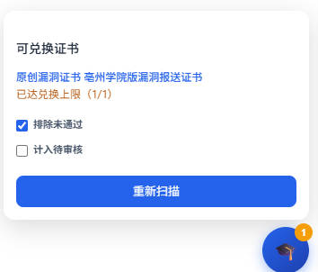

# EDUSRC 礼品兑换助手

登录 [EDUSRC](https://src.sjtu.edu.cn) 后，自动匹配你可兑换的**漏洞证书**与**实物礼物**。

EDUSRC [礼品中心](https://src.sjtu.edu.cn/gift/) 分两类：

| 类型 | 链接 | 兑换方式 | 本扩展 |
|------|------|----------|--------|
| 漏洞证书 | [`gift_type=certificate`](https://src.sjtu.edu.cn/gift/?gift_type=certificate) | 按漏洞条件匹配（学校、等级、年度等） | ✅ 自动扫描匹配 |
| 实物礼物 | [`gift_type=tangible_gift`](https://src.sjtu.edu.cn/gift/?gift_type=tangible_gift&order=0) | 金币 + 漏洞条件（学校/等级/时间等） | ✅ 匹配漏洞 + 金币 + 库存 |

## 界面预览



右下角 🎓 悬浮窗展示可兑换证书与实物礼物，支持「排除未通过」「计入待审核」筛选，并显示各礼品的兑换进度（如已达兑换上限 1/1）。

## 特点

- 使用浏览器当前登录态，数据按用户隔离
- 全站悬浮窗（右下角 🎓），扩展弹窗也可扫描
- 自动翻页抓取漏洞、证书规则与实物礼物列表
- 漏洞证书：匹配漏洞条件 + 库存（不检查证书所需金币）
- 实物礼物：匹配漏洞条件 + 金币余额 + 库存 + 兑换上限
- 部分礼物需先获得漏洞报送证书，或含开发方/多校提交等人工审核条件
- 在礼品中心页面自动标注「可兑换 / 未满足」

## 安装

1. 打开 `chrome://extensions/`
2. 开启「开发者模式」
3. 加载已解压的扩展程序 → 选择 `edusrc证书兑换` 文件夹

## 使用

1. 登录 https://src.sjtu.edu.cn
2. 任意 EDUSRC 页面点 🎓，或点扩展图标 → **扫描可兑换礼品**

### 查看他人可兑换什么

1. 打开他人公开主页，例如 `https://src.sjtu.edu.cn/profile/45496/`
2. 点 🎓 → 自动切换到 **「他人」** 并分析（30 分钟内用缓存）
3. 或在悬浮窗 / 扩展弹窗输入 **用户 ID** 或 **profile 链接** → 点 **分析**

**说明（他人模式）：**

- 数据来自公开主页的漏洞列表（无审核状态），**Rank > 0** 视为已通过
- **金币按 Rank 估算**（平台 1:1），实际余额可能因兑换而不同
- 「需已获漏洞报送证书」类礼物**无法从公开页验证**，不会标为可兑换
- 开发方/厂商类、多校提交等复杂条件会提示自行核对

## 认可的状态

待审核、未通过 **不算**；以下状态 **算已通过**：

等待修复、已修复、已确认、已通过、已审核、修复中、已完成

## 文件结构

```
edusrc证书兑换/
├── manifest.json
├── background.js       # 缓存、跨标签扫描调度
├── content/
│   ├── engine.js       # 解析 + 匹配 + 抓取（核心）
│   ├── bridge.js       # 页面消息桥
│   ├── badge.js        # 悬浮窗 UI
│   └── badge.css
└── popup/              # 扩展弹窗
```
